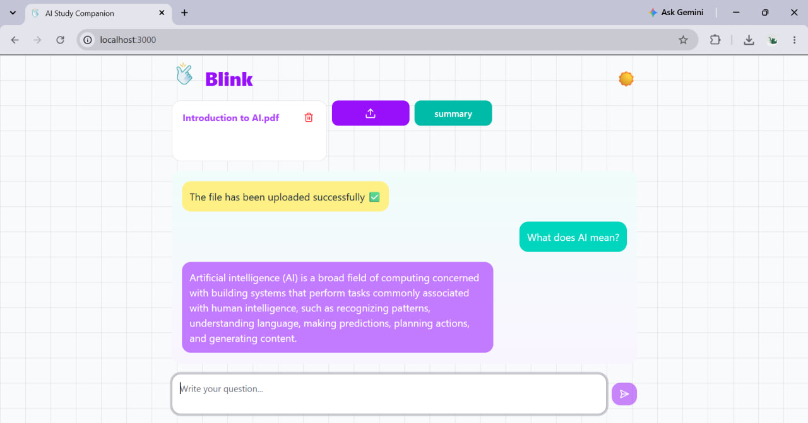
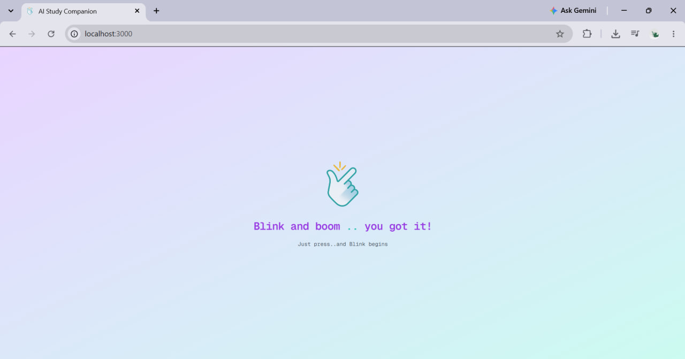
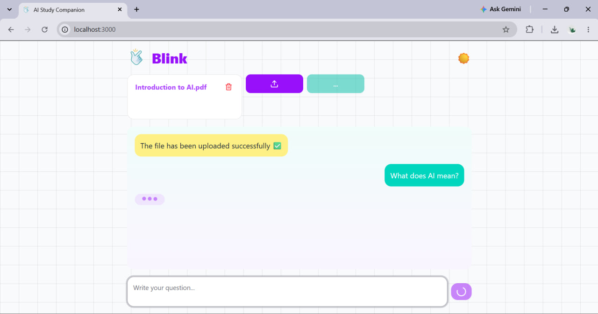
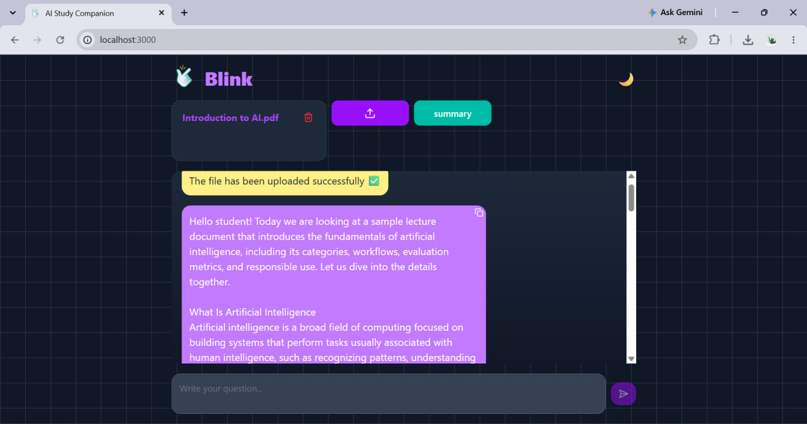
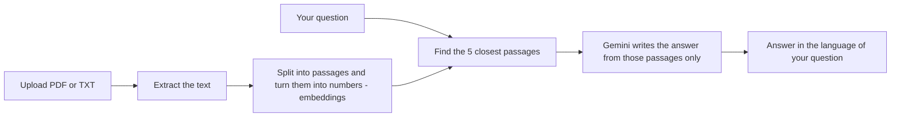

# Blink: AI Study Companion

> **Blink and boom... you got it!**
> Upload your study files, get a clear summary, and ask questions about them.
> The AI answers from **your document only**, in the language you ask in.

<p align="center">
  
</p>

---

## Table of contents

- [What is Blink?](#what-is-blink)
- [Features](#features)
- [Screenshots](#screenshots)
- [How it works](#how-it-works)
- [Tech stack](#tech-stack)
- [Project structure](#project-structure)
- [Getting started](#getting-started)
- [Configuration](#configuration)
- [API endpoints](#api-endpoints)
- [Security and privacy](#security-and-privacy)
- [Limitations](#limitations)
- [Troubleshooting](#troubleshooting)
- [Roadmap](#roadmap)

---

## What is Blink?

Blink is a study helper for students and for anyone who wants to understand a document quickly.
You upload a PDF or a text file, and Blink can:

- **summarize** the whole document in a simple, easy-to-read way, and
- **answer your questions** using only what is written in the document.

It works with **Arabic and English**. You can upload an English file and ask in Arabic, and the answer comes back in Arabic.

## Features

- Upload one or many **PDF** and **TXT** files
- **One-click summary** that covers the whole document (very long documents are summarized in parts, then combined)
- **Question answering** based on the document (RAG: the AI sees only the most relevant passages)
- **Cross-language**: ask in Arabic about an English file, or the other way around
- The answer follows the language of your question
- Light and dark mode
- Copy any message with one click
- Clear error messages (for example when the backend is not running or a file is rejected)
- Safe file handling: type check, size limit, and protected file names

## Screenshots

| splash screen | Chat (light mode) |
|:---:|:---:|
|  |  |

| Waiting for the answer | Summary (dark mode) |
|:---:|:---:|
|  |  |

## How it works

Blink uses a technique called **RAG** (Retrieval-Augmented Generation). Instead of giving the whole document to the AI, it first **searches** the document, then asks the AI to **answer using only what it found**.



1. **Embeddings (local):** a multilingual model (`paraphrase-multilingual-MiniLM-L12-v2`) runs on your computer. It turns text into numbers, so a question in one language can find a passage in another.
2. **Search:** the 5 passages closest in meaning to your question are selected.
3. **Answer:** Google Gemini receives those passages and your question, with instructions to answer only from them and in the language of the question.
4. **Summary:** the whole document is sent in one request when it is short enough. Longer documents are cut into parts, each part is summarized, and the summaries are combined into one final summary.

## Tech stack

| Part | Technologies |
|---|---|
| **Backend** | Python, FastAPI, Uvicorn |
| **RAG** | LlamaIndex (file reading, indexing, search), Sentence Transformers (local embeddings) |
| **AI model** | Google Gemini, through the official `google-genai` library |
| **Frontend** | Next.js 15 (App Router), React 19, TypeScript |
| **Design** | Tailwind CSS 4, shadcn/ui (Radix UI), Framer Motion, Lucide icons |

## Project structure

```
ai-study-companion/
├── backend/
│   ├── api.py            # Web API: validates requests and sends them to processing.py
│   ├── processing.py     # RAG pipeline: read files, search, ask Gemini, summarize
│   └── gemini_llm.py     # Small client that talks to the Gemini API
├── frontend/
│   ├── public/           # Static files (logo)
│   └── src/
│       ├── app/          # page.tsx (the interface), layout.tsx, globals.css
│       ├── components/ui # Ready-made UI components (shadcn/ui)
│       └── lib/          # Small helper functions
├── docs/images/          # Screenshots used in this README
├── uploaded_files/       # Created automatically. Your uploaded files are saved here
├── .env.example          # Example of the settings file (copy it to .env)
├── requirements.txt      # Python packages
└── README.md
```

## Getting started
<ghala-almalki>
BLINK

### What you need

- **Python 3.10.11 or newer**
- **Node.js 18.18 or newer** (Node 20+ is recommended)
- A **Google Gemini API key**. You can create one in [Google AI Studio](https://aistudio.google.com).

### 1. Get the code

```bash
git clone https://github.com/<ghala-almalki>/BLINK.git
cd BLINK
```

### 2. Set up the backend

Run these commands from the project folder (the one that contains `backend/` and `frontend/`).

**Windows (PowerShell):**
```powershell
python -m venv venv
venv\Scripts\activate
pip install -r requirements.txt
copy .env.example .env
```

**macOS / Linux:**
```bash
python3 -m venv venv
source venv/bin/activate
pip install -r requirements.txt
cp .env.example .env
```

Now open the new `.env` file and write your Gemini API key:

```
GEMINI_API_KEY=your_key_here
```

> The first install takes a while because `torch` is large (several hundred MB).
> The first time you use the app, it also downloads the embedding model (a few hundred MB). After that it starts faster.

Start the backend:

```bash
python -m uvicorn backend.api:app --reload
```

The API runs on `http://127.0.0.1:8000`. You can test it in the browser at `http://127.0.0.1:8000/docs`.

### 3. Set up the frontend

Open a **second terminal**:

```bash
cd frontend
npm install
npm run dev
```

Open **http://localhost:3000**, click the start screen, upload a file, and ask your first question.

## Configuration

### Backend (`.env` in the project folder)

| Variable | Required | Default | Description |
|---|---|---|---|
| `GEMINI_API_KEY` | Yes | none | Your Google Gemini API key |
| `GEMINI_MODEL` | No | `gemini-3.5-flash-lite` | Which Gemini model to use. Model names change over time, so check Google AI Studio if you get a "model not found" error |
| `ALLOWED_ORIGINS` | No | `http://localhost:3000,http://127.0.0.1:3000` | Websites that may call the backend (separated by commas) |

### Frontend (optional)

| Variable | Default | Description |
|---|---|---|
| `NEXT_PUBLIC_API_URL` | `http://127.0.0.1:8000` | Address of the backend. Put it in `frontend/.env.local` if you change it |

## API endpoints

Interactive documentation is available at `http://127.0.0.1:8000/docs` while the backend is running.

| Method | Endpoint | Description |
|---|---|---|
| `GET` | `/files/` | List the uploaded files |
| `POST` | `/upload/` | Upload PDF or TXT files (form field `files`, up to 20 files, 20 MB each) |
| `DELETE` | `/delete/{filename}` | Delete an uploaded file |
| `POST` | `/chat/` | Ask a question. Body: `{"question": "...", "filenames": ["file.pdf"]}` |
| `POST` | `/summarize/` | Summarize files. Body: `{"filenames": ["file.pdf"]}` |

## Security and privacy

What the project already does:

- **Safe file names:** names are cleaned and checked, so a file cannot be written outside the uploads folder (protection against path traversal).
- **File checks:** only PDF and TXT files, a 20 MB size limit, and PDFs must really be PDFs.
- **Limited CORS:** only the websites listed in `ALLOWED_ORIGINS` can call the backend from a browser.
- **Safe errors:** users see short, general error messages. Technical details stay in the server log.
- **Safe display:** the interface never renders AI output as HTML.
- **Prompt-injection protection:** document text is marked as data, and the AI is told to ignore any instructions written inside it.
- **Secrets:** the API key lives in `.env`, which is excluded from Git.

Please read these points:

- ⚠️ **Your files are sent to Google Gemini** to create answers and summaries. On free tiers, Google may use submitted content to improve its products (check Google's current terms). **Do not upload private or sensitive files.**
- ⚠️ **There are no user accounts.** All uploaded files are shared by everyone who can reach the app. Blink is designed to **run locally on your own computer**. Do not put it on a public server without adding authentication first.
- AI can make mistakes. Blink tells the model to answer only from the document, but you should still check important answers in the original file.

## Limitations

- **Scanned PDFs** (pages that are only images) are not supported, because there is no OCR yet.
- The search index is kept **in memory**, so it is rebuilt after the backend restarts.
- Very long documents take longer to summarize, because they are summarized in several steps.
- The free Gemini tier has usage limits. If you hit them, wait a little or use another model.
- The frontend uses Next.js 15. `npm audit` may report a PostCSS advisory inside Next.js that is only fixed in Next.js 16 (an upgrade is planned).

## Troubleshooting

| Problem | What to do |
|---|---|
| "Cannot reach the server" | The backend is not running or is still starting (it loads the AI models first). Check the first terminal and wait a few seconds |
| CORS error in the browser console | Add your frontend address to `ALLOWED_ORIGINS` in `.env`, then restart the backend |
| "GEMINI_API_KEY is missing" | Create the `.env` file (copy `.env.example`) and add your key |
| "Gemini request failed" | Check your API key, the model name in `GEMINI_MODEL`, and your quota |
| A file is rejected | Only PDF and TXT files up to 20 MB are accepted |
| "No text could be extracted" | The PDF is probably scanned (images only) |

## Roadmap

Ideas for the future:

- [ ] OCR support for scanned PDFs
- [ ] User accounts and private storage for each user
- [ ] Streaming answers (text appears while it is written)
- [ ] Export the summary as a file
- [ ] Automated tests
- [ ] Docker setup
- [ ] Upgrade to Next.js 16
